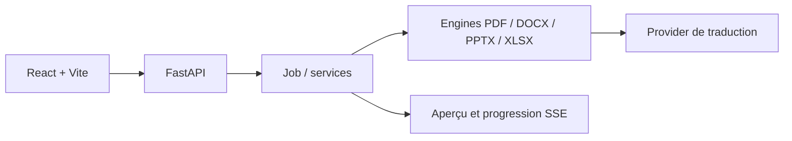

<!-- appfactory:hero:start -->
<div align="center">

# Précis Translator

### La traduction, sans sacrifier la mise en page.

**Traduire PDF et documents Office avec des moteurs adaptés à chaque format, des aperçus progressifs et une architecture qui respecte le document d'origine.**

[](#formats-pris-en-charge)
[](#promesse-produit)
[](#architecture-de-traduction)
[](#formats-pris-en-charge)

[**Promesse**](#promesse-produit) · [**Formats**](#formats-pris-en-charge) · [**Architecture**](#architecture-de-traduction) · [**Limites**](#limites-et-transparence) · [**Démarrer**](backend/README.md) · [**Documentation**](ARCHITECTURE.md)

</div>

---
<!-- appfactory:hero:end -->

## Promesse produit

**Un fichier traduit doit rester un document utilisable.** Précis Translator recherche la fidélité structurelle : extraction du texte avec sa géométrie et ses styles, traduction, puis réinjection à l'intérieur des conteneurs du document. L'approche ne garantit pas l'identité pixel par pixel de chaque fichier ; la recette dépend de la typographie, des documents et des moteurs.

La séparation `api → services → engines` permet de tester les moteurs sans importer l'application FastAPI et de corriger les défauts de rendu à l'aide de documents synthétiques. [Consulter la conception](ARCHITECTURE.md).

## Formats pris en charge

**Maturité déclarée : beta.** Les moteurs PDF, DOCX, PPTX et XLSX possèdent du code et des guides dédiés, mais les cas limites doivent être vérifiés sur les documents représentatifs.

| Format | Approche | Référence |
| --- | --- | --- |
| PDF numérique | Géométrie, polices et rendu progressif | [Moteur PDF](backend/engines/pdf/CONTEXTE.md) |
| DOCX | Texte et structure Word | [Moteur DOCX](backend/engines/docx/CONTEXTE.md) |
| PPTX | Texte et objets dans les diapositives | [Moteur PPTX](backend/engines/pptx/CONTEXTE.md) |
| XLSX | Cellules, graphiques et contraintes de largeur | [Moteur XLSX](backend/engines/xlsx/CONTEXTE.md) |
| PDF scanné | OCR étudié, non déclaré livré | [Étude OCR](docs/etude-ocr.md) |

**Versions :** le `package.json` de ce dépôt déclare actuellement `1.6.2`. Cette valeur ne prouve pas qu'une release correspondante soit effectivement déployée ; consulter les manifestes des moteurs, le [changelog](CHANGELOG.md) et les étapes de recette.

## Architecture de traduction



Les appels lourds ne doivent pas bloquer la boucle asynchrone. Les moteurs sont indépendants de l'API, et les caches de rendu sont versionnés pour éviter de servir d'anciens aperçus après un correctif.

## Limites et transparence

- La traduction de scans et les traitements OCR font l'objet d'une [étude](docs/etude-ocr.md) : ils ne doivent pas être présentés comme livrés.
- Les conversions peuvent nécessiter **LibreOffice** et des polices de repli ; la géométrie des documents complexes reste un risque de rendu.
- Une batterie de tests locale n'est pas une garantie de fidélité sur tous les documents réels ; voir la [recette de production](docs/feuille-de-route-production.md).
- L'utilisation du fournisseur de traduction, le déploiement et les paiements doivent être validés dans l'environnement concerné, sans secrets dans les exemples publics.

**Périmètre du dépôt public :** vitrine et code visible. L'état exact du déploiement doit être vérifié séparément ; la présence d'un autre dépôt de développement n'est pas une preuve de synchronisation.

## Démarrer

```bash
npm run dev                      # backend + interface, avec les adresses
```

Séparément : [`backend/README.md`](backend/README.md) ·
[`frontend/README.md`](frontend/README.md)

Prérequis : Python 3.12+, Node 20+, PostgreSQL, et **LibreOffice** pour les
aperçus non-PDF.

## Où lire quoi

| | |
|---|---|
| [`ARCHITECTURE.md`](ARCHITECTURE.md) | Les couches, la règle de dépendance, le chemin d'une traduction |
| [`backend/README.md`](backend/README.md) | API, configuration, tests |
| [`frontend/README.md`](frontend/README.md) | Interface, flux d'aperçu, variables `VITE_` |
| [`backend/engines/CONTEXTE.md`](backend/engines/CONTEXTE.md) | Ce que tous les moteurs partagent |
| [`backend/engines/pdf/CONTEXTE.md`](backend/engines/pdf/CONTEXTE.md) | Le moteur PDF — et sa clé de cache |
| [`backend/engines/pptx/CONTEXTE.md`](backend/engines/pptx/CONTEXTE.md) | Le moteur PPTX — parties partagées, objets OLE |
| [`backend/engines/docx/CONTEXTE.md`](backend/engines/docx/CONTEXTE.md) | Le moteur DOCX |
| [`backend/engines/xlsx/CONTEXTE.md`](backend/engines/xlsx/CONTEXTE.md) | Le moteur XLSX — texte couvert (cellules, onglets, graphiques, commentaires, tableaux, croisés, formats) |
| [`docs/feuille-de-route-production.md`](docs/feuille-de-route-production.md) | **Aller en production** : les 6 étapes dans l'ordre, qui fait quoi, et la preuve de chacune |
| [`docs/deploiement.md`](docs/deploiement.md) | **Mettre en ligne** : machine AWS, configuration, HTTPS, limites connues |
| [`docs/etude-ocr.md`](docs/etude-ocr.md) | Étude : traduire des PDF **scannés** (OCR) — feature à venir |
| [`docs/etude-visionneuse.md`](docs/etude-visionneuse.md) | Étude : visionneuse (navigation, molette, vignettes), fidélité de la retraduction compacte, originaux côté admin |
| [`docs/etude-invitations.md`](docs/etude-invitations.md) | Étude : inviter des proches par e-mail — choix et points à trancher |
| [`docs/etude-source-credits.md`](docs/etude-source-credits.md) | Étude : source des crédits — téléchargement et filigrane (gratuit, bêta, payant) |
| [`docs/etude-frais-carte.md`](docs/etude-frais-carte.md) | Étude : frais propres au paiement par carte (Paddle) |
| [`docs/etude-normalisation-main.md`](docs/etude-normalisation-main.md) | Étude : corrections après fusion de main 1.6.2 (frais hors cartes, minimum carte Paddle, mentions sous les cartes) |
| [`docs/etude-section-a-propos.md`](docs/etude-section-a-propos.md) | Étude : section « À propos » de l'accueil — structure recommandée et points à trancher |
| [`docs/etude-pptx-traduction-apercu.md`](docs/etude-pptx-traduction-apercu.md) | Étude : PPTX non traduit (diapositives `slide1000.xml`, ordre réel) et aperçu qui clignote |
| [`docs/etude-onglets-beta-pied.md`](docs/etude-onglets-beta-pied.md) | Étude : onglets admin cachés sur `/beta`, offre Bêta masquée si fermée, pied de barre latérale compact |
| [`docs/etude-audit-beta.md`](docs/etude-audit-beta.md) | Étude : audit du programme bêta (écarts et décisions) |
| [`docs/etude-anti-abus.md`](docs/etude-anti-abus.md) | Étude : anti-abus du gratuit et de la bêta (machine, cumul, e-mails jetables) |
| [`docs/etude-interfaces-admin.md`](docs/etude-interfaces-admin.md) | Étude : refonte des interfaces d'administration (gabarit commun, campagne bêta, page /beta) |
| [`docs/etude-fiche-utilisateur-integree.md`](docs/etude-fiche-utilisateur-integree.md) | Étude : fiche utilisateur à droite de la liste des comptes (plus de panneau latéral) |
| [`docs/etude-historique-forfaits.md`](docs/etude-historique-forfaits.md) | Étude : historique des forfaits, fiche compte en pleine hauteur, tuiles cliquables |
| [`docs/etude-menu-admin.md`](docs/etude-menu-admin.md)
- [Étude — programmes Bêta multiples](docs/etude-programmes-beta.md) | Étude : « Administration » dans le menu principal, onglets admin dans la barre |
- [Étude — fiche programme Bêta lisible](docs/etude-fiche-programme-beta.md)
- [Étude — accès Bêta direct et fiche simplifiée](docs/etude-acces-beta-direct.md)
- [Étude — aperçu d'un document aux fichiers disparus](docs/etude-apercu-fichier-manquant.md)
- [Étude — page publique Bêta simplifiée](docs/etude-page-beta.md)
| [`docs/guide-premiere-mise-en-ligne.md`](docs/guide-premiere-mise-en-ligne.md) | Pas à pas de la toute première mise en ligne |
| [`infra/aws/README.md`](infra/aws/README.md) | L'infrastructure AWS (CloudFormation, OIDC, secrets) |
| `docs/api/index.html` | Les 32 opérations HTTP (`npm run docs:api`) |
| [`CONTRIBUTING.md`](CONTRIBUTING.md) | **Ajouter une fonctionnalité** : cycle, checklist, versions, retour arrière |
| [`CHANGELOG.md`](CHANGELOG.md) | L'historique des versions |
| [`TODO.md`](TODO.md) | Ce qui reste à faire, par priorité |
| [`PASSATION.md`](PASSATION.md) | Où en est le travail en cours (reprise de session) |

> L'historique détaillé des campagnes de correction (mesures, essais, impasses)
> n'encombre plus la racine : il reste consultable dans l'**historique git**. La
> carte à jour est dans `ARCHITECTURE.md` et les `CONTEXTE.md` par moteur.

## Les commandes

```bash
npm run dev              # backend + frontend
npm run dev:backend      # uvicorn seul
npm run dev:frontend     # Vite seul
npm run docs:api         # régénère docs/api/index.html
npm run stop             # arrête les deux
```

## Ce qui ne se négocie pas

**Un moteur n'importe jamais l'application.** `api → services → engines → rien`.
Le contrôle tient en une ligne, et il doit rester vrai :

```bash
cd backend && venv/Scripts/python.exe -c "import engines, sys; \
  print([m for m in sys.modules if m.startswith('app')])"     # => []
```

**Rien de bloquant dans un `async def`.** Un seul appel synchrone y fige
l'application entière, flux SSE compris.

**Aucune heuristique calée sur un document.** Un correctif se prouve sur un
document **synthétique**, jamais sur celui qui a révélé le défaut — sinon il
tiendra jusqu'au document suivant.

**Le cache de rendu est versionné.** Tout correctif qui peut changer un pixel
impose d'incrémenter la version du moteur PDF. L'oublier resert un rendu périmé
**en silence** : on croit avoir corrigé, l'utilisateur voit le contraire.

## Vérifier

```bash
cd backend
for t in tests/test_*.py; do venv/Scripts/python.exe "$t"; done
```

Trente-neuf suites, hors ligne. Une suite doit sortir en `exit=0` :
un score vert avec un code de retour non nul cache toujours quelque chose.

Les documents réels de recette (non versionnés, trop lourds) vivent dans
`backend/tests files/` : `Code_de_la_Route.pdf`, `The Data Science
Handbook.pdf`, `mv21.pdf`, et `scans/` (scans synthétiques + vérité terrain).

## Arborescence

```
backend/      API FastAPI (app/), moteurs (engines/), migrations, tests, polices
frontend/     Interface React + Vite
docs/         Déploiement, feuille de route, étude OCR, doc API générée
infra/aws/    Infrastructure AWS (CloudFormation)
deploy/       Compose de production et script de déploiement SSM
scripts/      Lanceurs de développement (dev.py, stop.cmd, precis.sh, docs_api.py)
release/      Version globale du projet
```
